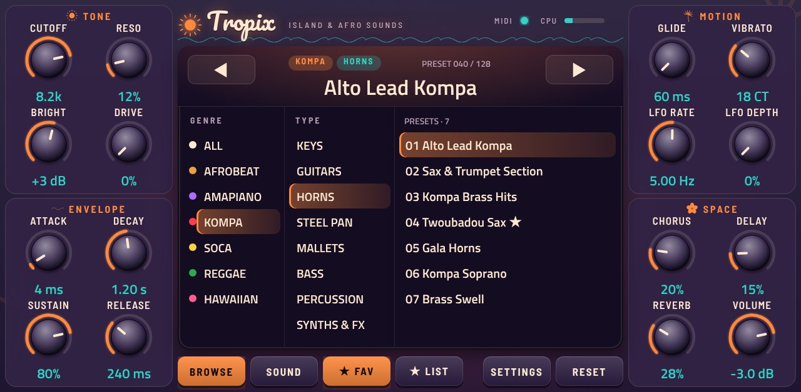
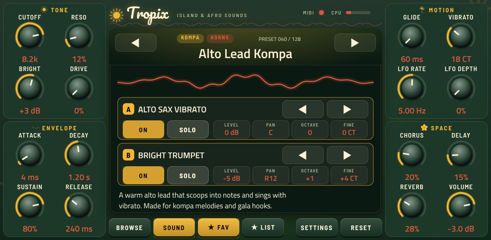
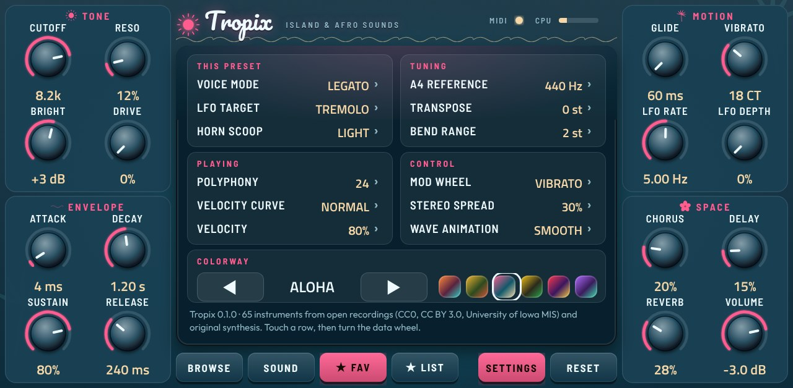
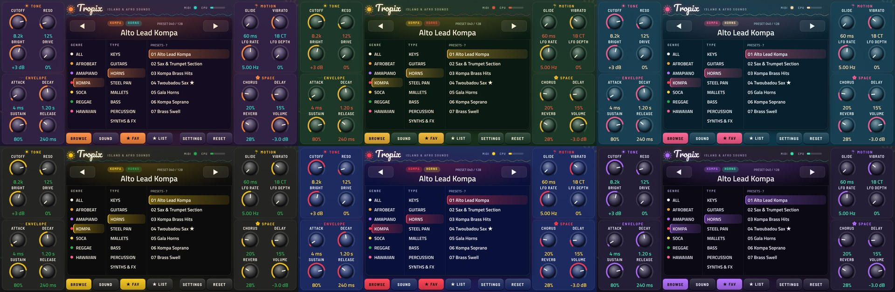

# Tropix

Island and afro sounds for Akai MPC standalone devices: a ROMpler with 128 presets and 65 instruments for
afrobeat, amapiano, Haitian kompa, soca, reggae and Hawaiian music. It runs natively on the MPC as an ARM VST2
plugin, built on [sd88me/mpc-vst-plugins](https://github.com/sd88me/mpc-vst-plugins).



## Features

- **128 presets**, browsed by genre (afrobeat, amapiano, kompa, soca, reggae, Hawaiian) and type (keys, guitars,
  horns, steel pan, mallets, bass, percussion, synths & FX). They also appear in MPC's own PRESET list.
- **65 instruments** from open recordings and original synthesis, about 200 MB: modeled steel pans (tenor, double
  second, cello, bass and a sustained roll), five amapiano log drums, saxes (alto, tenor, soprano, with and without
  vibrato) and trumpets (open, bright, harmon, stabs), trombones, harmonica and melodica; hollow-body and archtop
  electrics for kompa and highlife, slack-key steel, palm-wine nylon, ukulele, pedal and lap steel; grand and upright
  pianos, tine, reed and electric-grand e-pianos, FM keys and three organs; marimba, balafon, vibraphone, kalimba,
  mbira; flatwound and finger basses, sub; island and West African percussion kits, timbales and ipu; soca leads,
  brass, plucks and pads.
- **Two layers per preset**, each with its own sound, level, pan, octave, fine tune, on and solo.
- **Playing like a horn player:** glide, a scoop into the note, a vibrato that comes in on held notes, and
  mono / legato voice modes.
- **Sound shaping:** cutoff, resonance, bright (a treble tilt), drive, the amp envelope, an LFO for tremolo, filter
  or auto-pan, chorus, a tempo-synced delay and reverb.
- **Favourites:** star any preset and find them all in one list.
- **Six colorways:** Sunset, Lagos, Aloha, Kingston, Kanaval, Jozi Night.
- **Made for the MPC:** the 16 knobs are the Q-Links in four columns of four, on every view; big knobs and
  buttons, everything on one page; edits, favourites and the colorway are saved with the project.

## The page

The 16 knobs sit on either side (TONE, ENVELOPE, MOTION, SPACE: one Q-Link column each; Q-Link 16 browses presets,
since the MPC track has its own volume). The screen in the middle has three views, picked along its foot.

### BROWSE

Tap a genre, then a type, then a preset. Tap the lit type again to see every type in that genre. The list shows
8 presets at a time; ◀ ▶ in the header (or the data wheel, or touching the preset's name and dragging) steps through
the list and its pages follow.

### SOUND



The waveform, both layers and the preset's description. For each layer: ◀ ▶ change its sound (or touch the name and
turn the data wheel), ON, SOLO, and LEVEL, PAN, OCTAVE and FINE (touch one, then turn the data wheel). On a
percussion kit, OCTAVE moves the kit along the keyboard instead of retuning it.

### SETTINGS



THIS PRESET (voice mode, LFO target, horn scoop: saved in the preset), TUNING (A4 reference, transpose, bend
range), PLAYING (polyphony, velocity curve, velocity), CONTROL (mod wheel, stereo spread, wave animation) and the
colorway. Touch a row and turn the data wheel; a tap steps a row that has a list of choices.

| Button | What it does |
| --- | --- |
| BROWSE, SOUND, SETTINGS | the screen's three views |
| ★ FAV | mark or unmark the current preset as a favourite |
| ★ LIST | list every favourite; tap again to go back |
| RESET | undo your edits to the current preset (it lights when there are some) |

### Colorways



## Install

Build on a Windows PC with WSL (Ubuntu) and Docker Desktop: start Docker Desktop, then run in Ubuntu

```sh
cd ~ && { [ -d Tropix ] || git clone https://github.com/3dthc/Tropix.git; } && cd Tropix && git pull && bash install.sh
```

The first build packs the instruments (a few minutes). It ends with `Tropix-<version>-mpc-armv7.zip` in your Windows
Downloads. Install it on the MPC like any other plugin, then restart the MPC. TESTING.md has a checklist for trying a
new build.

## Sound sources

Every sampled sound comes from recordings that allow redistribution in a public plugin (CC0, CC BY 3.0, or "free to
use for any projects, without restrictions"); sounds with no good free source are synthesized from scratch by the
engines in `tools/`. Sources, licenses and credits per instrument are in `library/LICENSES.md` (shipped in the
release zip) and per file in `library/files.csv`. The Wurlitzer EP200, Yamaha CP80 and Hohner Pianet T samples are by
Greg Sullivan (CC BY 3.0); the plugin calls them by generic names.

## Building from source

### Repository layout

| Path | What |
| --- | --- |
| `src/engine.c` | the plugin engine (`mpc_engine()`, see mpc-vst-plugins `wrapper/engine.h`) |
| `src/instruments.h` | the instrument table (generated by `tools/pack_tropix.py`) |
| `src/params.h`, `src/presets.h`, `vst/params.json` | the parameters and the factory presets (generated by `tools/tropix_params.py` from it and `tools/presets.py`) |
| `vst/` | `vst.json`, `params.json`, `build.sh` for mpc-vst-plugins' `build_port.sh` |
| `vst/layout.conf`, `vst/art/` | the faceplate: layout and artwork, both drawn by `tools/make_skin.py` |
| `vst/fonts/` | Pacifico, Outfit, Barlow Semi Condensed (SIL Open Font License) for the baked artwork |
| `library/<instrument>/` | every instrument's samples (FLAC) and `keymap.json` (zones, loops, tuning, the original file) |
| `tools/` | the library pipeline: builders, synthesis engines, checks, packing, demos, the skin and the presets |
| `engine/` | the packed instruments the plugin loads (built by `tools/pack_tropix.py`, not committed) |

### Steps

```sh
python3 -I tools/pack_tropix.py  # engine/*.tpx and src/instruments.h from library/
python3 tools/tropix_params.py   # vst/params.json, src/params.h, src/presets.h (the presets are tools/presets.py)
python3 tools/balance.py         # optional: re-measure the presets' loudness trims (tools/preset_trim.json)
python3 tools/make_skin.py       # vst/art/ and vst/layout.conf (needs Playwright's Chromium)
bash vst/build.sh                # the plugin and skin (Docker)
./make_release.sh 0.1.0          # dist/Tropix-0.1.0-mpc-armv7.zip
```

Offline checks: `tools/render_test.c` plays every preset through the real engine and writes WAVs
(`cc -O2 -I../mpc-vst-plugins/wrapper -Isrc tools/render_test.c -lm -lpthread -o render_test && ./render_test engine out`),
and mpc-vst-plugins' `tools/test_port.sh vst/vst.json` runs its host test under ASan.

The sample builders (`tools/build_*.py`) need the upstream sample sets in `raw/` (see `sources.json`) and Python 3
with numpy, scipy and soundfile; their output is committed in `library/`, so building the plugin does not need them.

## License

The code is MIT (see LICENSE). The samples keep their own licenses (library/LICENSES.md). Bank format, codec and
effects come from Sonix and Fretty (3dthc, MIT).
